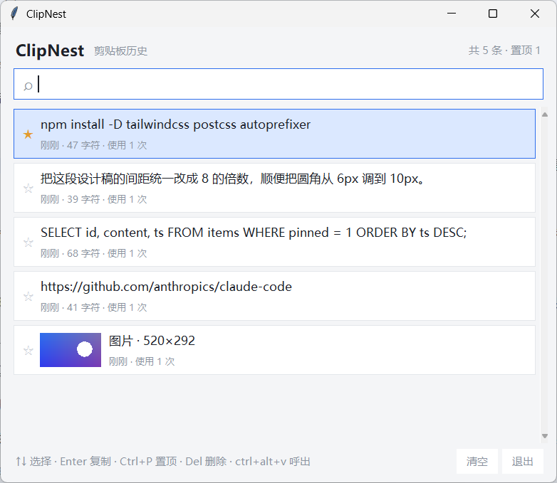

# ClipNest

Windows 剪贴板历史管理器。后台记录复制过的文字和图片，按 `Ctrl+Alt+V` 呼出，搜一下就能重新复制。



数据存在本地 SQLite 文件里，不联网。只用 Python 标准库，不需要装第三方包。

## 功能

- 记录文本和图片，图片显示缩略图，复制时按原始 DIB 写回
- 模糊搜索：前缀、子串、词边界、多词命中、子序列依次降级匹配
- 条目可以置顶，清空历史时置顶项保留
- 全局热键呼出，回车复制后窗口自动隐藏
- 内容相同的记录合并成一条，累加使用次数并移到最近
- 默认保留 500 条，超出后淘汰最旧的

## 运行

需要 Windows 和 Python 3.9 以上（[官方安装包](https://www.python.org/downloads/windows/) 自带 tkinter）。

```bash
git clone https://github.com/haha5274/clipnest.git
cd clipnest
python -m clipnest
```

双击 `run.pyw` 可以不弹控制台窗口。也可以 `pip install .` 装成命令，`clipnest --hidden` 启动即隐藏。

窗口出来后去别处复制点东西，再按 `Ctrl+Alt+V` 试试。

## 快捷键

| 按键 | 作用 |
| --- | --- |
| `Ctrl+Alt+V` | 显示或隐藏窗口（全局） |
| `↑` `↓` | 上下移动选择 |
| `Enter` | 复制选中项并隐藏窗口 |
| `Ctrl+P` | 置顶 / 取消置顶 |
| `Delete` | 删除选中项 |
| `Esc` | 先清空搜索框，搜索框为空时隐藏窗口 |
| 双击条目 | 直接复制 |

点 `☆` 也能切换置顶。关窗口只是隐藏到后台，退出要点右下角「退出」。

## 配置

首次运行生成 `%APPDATA%\ClipNest\config.json`：

```json
{
  "hotkey": "ctrl+alt+v",
  "max_items": 500,
  "poll_interval_ms": 250,
  "max_text_kb": 512,
  "capture_images": true,
  "dark": false
}
```

- `hotkey` 支持 `ctrl` / `alt` / `shift` / `win` 组合，主键可以是字母、数字、`F1`~`F24`，或者 `space`、`enter` 这类名字，必须带至少一个修饰键
- `max_items` 只限制非置顶条目
- `poll_interval_ms` 调大能省点 CPU，代价是复制后要等一下才记录
- `max_text_kb` 用来挡住误复制的大段日志

数据库是同目录的 `clipnest.db`，直接删掉就清空了。想放别处用 `--db`：

```bash
python -m clipnest --db D:\data\clipnest.db
```

## 一些实现选择

- **只在序号变化时读剪贴板。** `GetClipboardSequenceNumber()` 没变就整轮跳过，不碰剪贴板内容，挂后台时 CPU 占用接近 0。
- **PNG 是自己编的。** tkinter 只认 PNG 和 GIF，剪贴板给的却是 DIB。为此拉 Pillow 进来不划算，所以直接拼 IHDR/IDAT/IEND，用 `zlib.compress` 压扫描线、`zlib.crc32` 算校验。像素搬运走 `bytes` 步长切片（`line[0::4]`），由 C 层完成，4K 截图解码也在百毫秒级。
- **热键跑在独立线程。** `RegisterHotKey(None, ...)` 绑到线程消息队列，`GetMessageW` 循环收到 `WM_HOTKEY` 后把事件塞进 `queue`，由主线程的 `after` 泵取走。tkinter 不是线程安全的，这层隔离省不掉。

## 目录

```
clipnest/
├── clipnest/
│   ├── app.py          # 界面、轮询调度、事件泵
│   ├── winclip.py      # Win32 剪贴板读写
│   ├── imageutil.py    # DIB 解码 + PNG 编码
│   ├── hotkey.py       # RegisterHotKey + 消息循环
│   ├── store.py        # SQLite 存储、去重、淘汰
│   ├── search.py       # 匹配打分
│   └── config.py       # 配置读写
├── tests/
├── run.pyw
└── docs/screenshot.png
```

## 测试

```bash
python -m unittest discover -s tests -v
```

覆盖 DIB 解码（24/32 位、上下翻转）、PNG 编码（签名、尺寸、IDAT 解压比对、降采样）、搜索打分、存储层（去重、置顶、淘汰、清空），以及几个会真的开窗口的 UI 测试（搜索过滤、置顶排序、复制、删除、图片行渲染）。

## 限制

- 只支持 Windows
- 只处理 `CF_DIB`，文件拖放和富文本没做
- 没有托盘图标，隐藏后只能用热键唤出
- 同时只能跑一个实例，第二个会因热键被占用而提示注册失败

## TODO

托盘图标、开机自启、富文本和文件剪贴板、按日期归档。

## License

MIT
